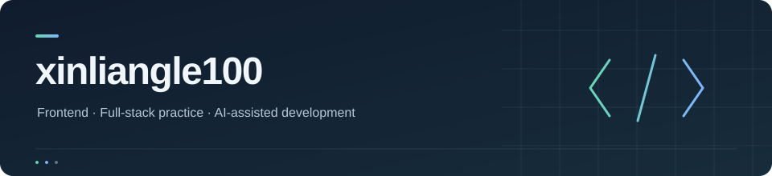

你好，我是 **Brad Alyx(xinliangle100)** 👋  
刚毕业、刚正式参加工作的小登一枚。  
前端出身，写过 Vue / React，现在借助 **AI 做全栈**。  
*PS：AI 负责全栈，我负责喝咖啡和学习 ☕*  
日常主力 agent 是 **[Pi](https://pi.dev/)**，Pi插件高度自定义真的很好用！！！  
模型方面各家厂商的 模型api 都在用，个人开发只有 gpt pro。  

### 技术栈

**前端背景**

主Vue，react。

**后端实践**

有 Node.js / NestJS、TypeORM、ThinkPHP 和 MySQL 的使用经历。

**正在深入**

Java / Spring Boot、后端与并发相关知识，以及 AI 编码工具的协作方式。

其他接触过的技术与方向

- Flutter / Dart、MQTT 与 Android 通知。
- Python 数据处理与可视化。
- Linux、Nginx 与服务部署相关知识。

### 个人项目

**[志愿报考网站](https://github.com/xinliangle100/zhiyuanbaokao_vue)**  
参考优志愿平台制作的网站，包含 Vue 前端与 ThinkPHP 后端，是我早期的个人项目实践。  
> *PS：纯手工代码，内含保持最原汁原味的bug，现在回头看真是没有规范全是curd，想到啥写啥，想要啥取啥，现在空了在尝试，react + nestjs重构*

[Vue 前端](https://github.com/xinliangle100/zhiyuanbaokao_vue) · [ThinkPHP 后端](https://github.com/xinliangle100/zhiyuanbaokao_thinkphp)
